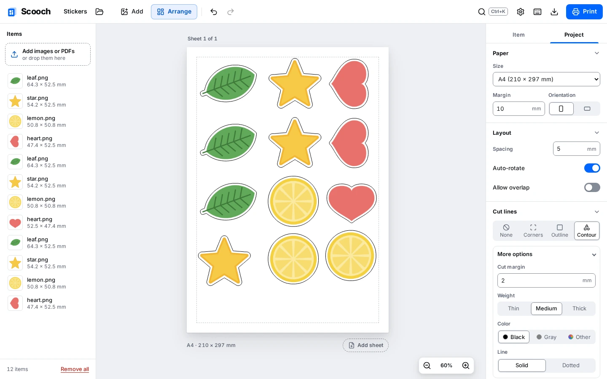
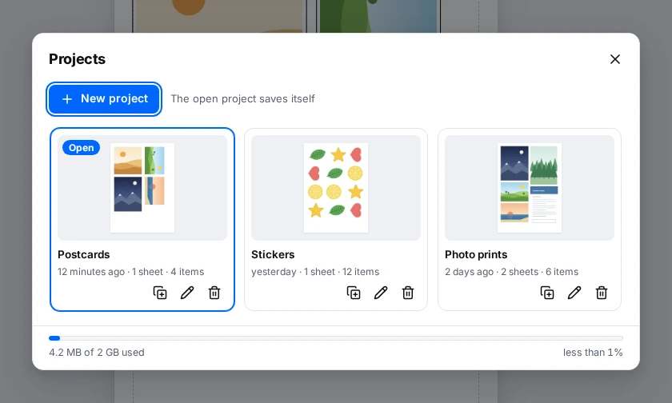
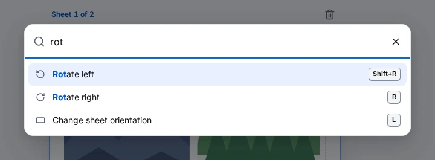
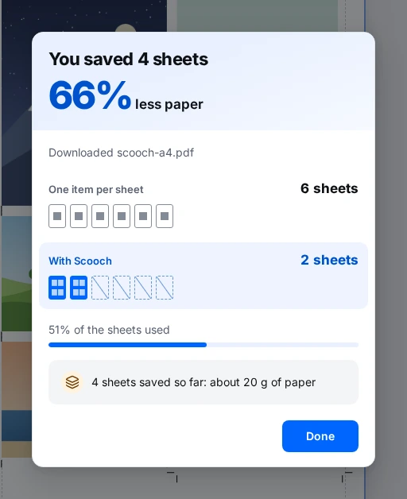
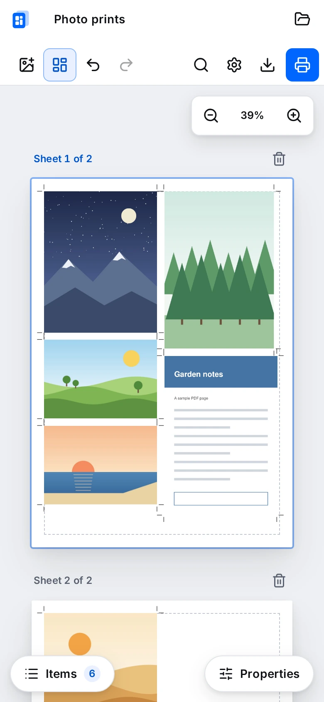

# Scooch

[](https://github.com/tzivigelstein/scooch/actions/workflows/ci.yml)

Scooch is a web app for printing images and PDF pages at their real size. You
place them on sheets of paper, let it arrange them so they take as few sheets
as possible, and print or download a PDF with one page per sheet. Everything
happens in your browser: files are never uploaded, and there are no accounts
and no analytics. It is free to use.

<!-- Once the public address is decided, add it as one line here, e.g. "Use it at https://…". -->


## What it does

- **Real size.** Every item has a physical size: images start at their size
  at 300 ppi and PDF pages at their page size (both reduced if they would take
  too much of the sheet), and you can set any size in mm, cm or inches. The
  PDF has one page per sheet at the paper's exact size: A0 to A6, B4, B5,
  Letter, Legal, Folio, Tabloid, photo papers or a custom size. Printed at
  100%, the items measure on paper what they measure on screen; a short note
  before printing says which print settings to choose.
- **Arrange.** One button (or the A key) places every item on as few sheets
  as it can, without overlaps, keeping the spacing you set and rotating items
  when that fits more (Auto-rotate). When the items no longer fit on one
  sheet, it offers to shrink them just enough to fit.
- **Several sheets.** What doesn't fit goes on the next sheet. Sheets can be
  added and removed, and items moved between them.
- **Cut lines.** Corner marks, an outline around each item, or **Contour**:
  for an image with transparency, such as a sticker, the line follows its
  shape at the cut margin you choose. Weight, color and solid or dotted lines
  are options. The lines are part of the PDF.
- **Crop.** Crop an image by hand, or to a standard photo size (4 × 6 in,
  5 × 7 in, passport 3.5 × 4.5 cm, visa 2 × 2 in and others).
- **Editing.** Move, resize and rotate; align and distribute; duplicate,
  fill a sheet with copies, copy and paste (including images pasted from other
  apps); a grid with snapping. Items that go off the sheet, cross the margin,
  overlap or may print pixelated are flagged.
- **Projects saved in this browser.** Work is saved as you go, as projects
  you can open, rename, duplicate and delete. The undo history (the last 50
  steps) is saved with each project, so Undo still works after a reload. A
  project opened in a second tab is saved by that tab only, and the first one
  says so: changes are never overwritten silently.
- **Keyboard first.** Ctrl+K (⌘K on a Mac) opens a command palette that finds
  any action by name. Everything can be done with the keyboard alone, most
  actions have shortcuts, and the shortcuts dialog lists them all.
  Single-key shortcuts such as A or R can be turned off.
- **Five languages, light and dark.** The interface is in English, Spanish,
  Simplified Chinese, Hindi and French: the browser's language, or the one
  chosen in Preferences. The theme follows the system or is set by hand.
- **Phones and tablets.** On narrow screens the panels move behind buttons;
  two fingers zoom and pan the sheets.
- **Paper saved.** After printing or downloading, a summary says how many
  sheets the arrangement saved compared with printing one item per sheet, with
  a running total kept on this device. It can be turned off.

## A closer look

Contour cut lines on a sheet of stickers, 2 mm from each shape, with the cut
line options open:



The projects saved in this browser, with the space they use:



The command palette, here finding the rotate commands for the selected item,
with their keys:



The summary after downloading the PDF:



The dark theme, with an item selected (its toolbar on the sheet, its
measurements in the Item tab):


On a phone:



## Privacy

- **Nothing leaves the browser.** Images and PDFs are read, and the PDF is
  made, on your device. There is no server side: the host only serves the
  app's static files (and, like any web host, sees the visits). Fonts and
  libraries are part of the build and come from the same address as the app;
  there are no third-party scripts, cookies or analytics.
- **Projects stay in this browser.** Projects, their files, their undo
  history and the preferences are kept in the browser's storage (IndexedDB and
  localStorage, under the `scooch` prefix). They don't sync to other
  browsers or devices, and clearing the site's data in the browser deletes
  them. Where the browser allows no storage (some private windows), the app
  still works, says that it can't save, and the work is gone when the tab
  closes.
- **How this is checked.** The static pages are tested to make no request
  outside their own origin (`e2e/specs/site-pages.spec.ts`). Every setting
  declares where it is kept (`src/state/settings.ts`, checked by
  `tests/state/settings-registry.test.ts`), and a test fails when a key the
  app keeps in localStorage is missing from the privacy policy draft
  (`tests/site/legal.test.ts`). The editor has no code that sends data
  anywhere, but no test yet checks that it never contacts another origin: a
  change that adds any request elsewhere also has to update the privacy
  policy ([docs/legal/README.md](docs/legal/README.md) lists what to check).

## Limits

- There is no offline mode: the app needs the network to load, and the PDF
  reader and writer load the first time they are needed.
- Up to 200 items per project; each file up to 40 MB and 60 megapixels.
  Images open if the browser can decode them: JPEG, PNG and WebP in every
  browser below; other formats, such as HEIC, depend on the browser.
  Password-protected PDFs are refused.
- The translations other than Spanish still await review by native speakers,
  the site's pages too; the translated terms and privacy policy say the
  Spanish versions are the reference until a lawyer reviews them.

## Browsers

The browser test suite runs on every push to `main` and every pull request,
in GitHub Actions, on Playwright's Chromium, WebKit and Firefox (on Linux),
and all three have to pass. A few tests skip themselves where Playwright can't
drive an engine, saying why: touch gestures run only in Chromium, and so does
printing from a hidden frame (Safari opens the PDF in a new tab instead, and
Playwright's Firefox has no PDF viewer). Playwright's WebKit is close to
Safari but is not Safari, and the app has not been tested on every real
device; reports from Safari, iOS and Android are welcome.

## Development

Requires Node.js 24 (`.nvmrc` pins the major: `nvm use`) and Yarn 1.22.

```sh
yarn install                       # dependencies (CI uses --frozen-lockfile)
yarn playwright install chromium   # once, for the browser tests and the screenshots
yarn dev                           # development server with hot reload
yarn build                         # production build in dist/
yarn preview                       # serves dist/
yarn typecheck                     # TypeScript: src, tests and e2e
yarn test                          # every Vitest project
yarn e2e                           # browser tests (Playwright) against a production build
yarn size                          # gzip sizes of dist/ against their budgets (after a build)
yarn ledger                        # checks e2e/ledger.csv against the existing tests
yarn verify                        # typecheck, test, build, size, e2e and ledger, in that order
yarn screenshots                   # regenerates the images in docs/images/
```

React 19 and TypeScript, Zustand for state and Vite for the build. pdf.js
reads PDFs and pdf-lib writes them; both load only when first needed.
`yarn e2e` serves its build on 127.0.0.1:4319 and `yarn screenshots` on
127.0.0.1:4800, so neither touches the development server (5173). The
screenshots are taken by `scripts/screenshots.mjs` from a production build in
Chromium, with sample pictures it draws itself; run `yarn screenshots` after a
change that shows in them.

### Project layout

```
index.html          the single page: critical CSS, the editor's skeleton, theme and language chosen before the first paint
src/
  main.tsx, App.tsx start and layout
  config.ts         app name, limits and storage keys
  core/             pure logic, no DOM: packing, alignment, crop, cut lines and contours, units, zoom, the project format and its migrations
  state/            Zustand stores, selectors, the undo history and the commands registry
    actions/        everything that changes the document, one undo step per operation
  services/         reading files, writing the PDF, printing, projects and their storage (storage/: IndexedDB and localStorage)
  components/       React components by area, each with its stylesheet beside it
  hooks/            keyboard shortcuts, pointer and touch gestures, focus rescue
  copy/             every interface text: one catalogue per language (es.ts is the source), used through t()
  site/             the static pages rendered at build time: guides, questions, legal pages, sitemap
  styles/           shared stylesheets; index.css declares the cascade layers
tests/              Vitest tests by layer
e2e/                Playwright specs, their helpers, fixtures and the ledger
scripts/            the size check and its budgets, the screenshot script
docs/               the guides below and the README's images
```

A few rules shape the code:

- Lengths in the document are millimeters. Every conversion between screen
  pixels and millimeters goes through `src/components/canvas/viewport.ts`;
  the sheets' zoom is view state and never changes the printed size.
- The interface is sized in rem from the browser's own font size, so it
  follows the browser's zoom and text size, never the screen's width.
- Components subscribe to the slices of state they show. Everything that
  changes the document goes through `src/state/actions/`, so each operation
  is one undo step.
- Every action is listed once in `src/state/commands.ts`; the command
  palette, the shortcuts dialog and the context menus read it.
- Styles are plain CSS next to their component (`Stage.css` beside
  `Stage.tsx`). Cascade layers, declared once in `src/styles/index.css`, fix
  the order, so the order stylesheets load in can't change the result. Parts
  that load later bring their own stylesheet.
- Stored formats are frozen: every version of the project document ever
  saved keeps opening (`DOC_VERSION` in `src/core/projectdoc.js`, with a test
  fixture per version), and any change to it, or to what IndexedDB and
  localStorage keep, comes with a new version and a migration.
  [CONTRIBUTING.md](CONTRIBUTING.md#stored-formats-are-frozen) has the
  details.

### Tests

Each check lives in the lowest layer that can make it: pure functions in unit
and property tests, document rules by calling the actions on the real stores,
single controls with Testing Library, and only what needs a real browser
(pointer and touch, focus, geometry on screen, storage across reloads,
printing, the exported PDF, accessibility scans with axe in both themes) in
Playwright against the production build. There are no retries and no quick
mode. [docs/testing.md](docs/testing.md) explains the layers, how to run part
of them, how CI is organized and how to reproduce a failure.

### Deploying

The build is static files in `dist/`. On Vercel, importing the repository
needs no configuration; `vercel.json` adds clean URLs and long cache headers
for the hashed assets. A production release needs `SITE_URL` and the legal
texts completed: [docs/site.md](docs/site.md) explains what stops it.

## Documentation

- [docs/testing.md](docs/testing.md): test layers, running them, CI and size
  budgets.
- [docs/copy.md](docs/copy.md): the copy guide (in Spanish), with a glossary
  per language in [docs/copy/](docs/copy).
- [docs/site.md](docs/site.md): the static pages and what a release needs.
- [docs/deep-links.md](docs/deep-links.md): links that open the editor with a
  new project set up.
- [docs/legal/README.md](docs/legal/README.md): the drafts of the terms and the
  privacy policy, and how to keep them true.

## Contributing

Bug reports, ideas and pull requests are welcome. Read
[CONTRIBUTING.md](CONTRIBUTING.md) first: it covers the setup, the
conventions and the contribution terms. For anything bigger than a small fix,
open an issue first. Security problems go privately, as
[SECURITY.md](SECURITY.md) explains. Everyone taking part follows the
[Code of Conduct](CODE_OF_CONDUCT.md).

## License

Scooch is source-available under the
[PolyForm Noncommercial License 1.0.0](LICENSE). In plain words: anyone may
use, read, change and share the code for any noncommercial purpose, including
personal use and use by charities, schools, public research organizations and
government institutions. It is not an open-source license.

Using the app at its official site is allowed for any purpose, commercial work
included: a print shop, someone selling stickers or a business printing its
own material may use it, and what they make with it (the PDFs, the prints) is
theirs to use and sell, with no fee, credit or permission needed. The
licensor gives that permission in
[LICENSE-EXCEPTION.md](LICENSE-EXCEPTION.md), and the terms of use say the
same. What is not allowed is commercializing Scooch itself: selling it,
charging for access to it, hosting a copy with ads, including it in a paid
product or service, or offering the code or a changed version commercially.
Those, and any other commercial use of the code, need the licensor's written
permission.

The license text and the additional permission are what apply; this summary
is not a substitute for them.

The third-party software in the build, each under its own license, is listed
in [THIRD_PARTY_NOTICES.md](THIRD_PARTY_NOTICES.md).
